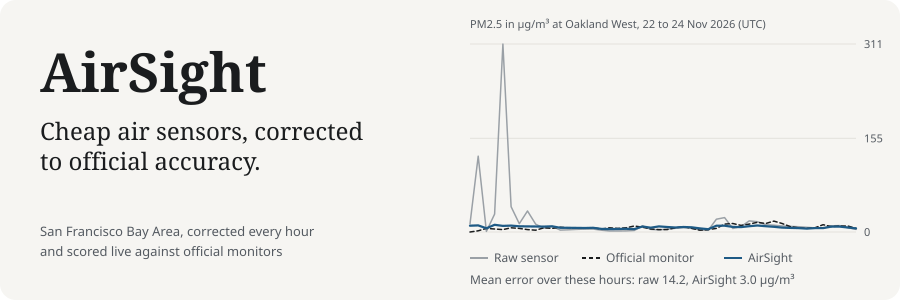
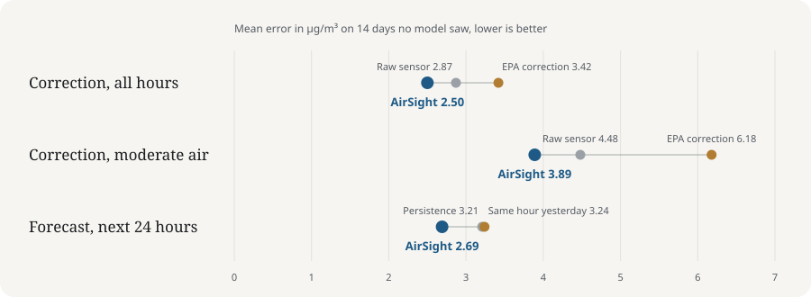
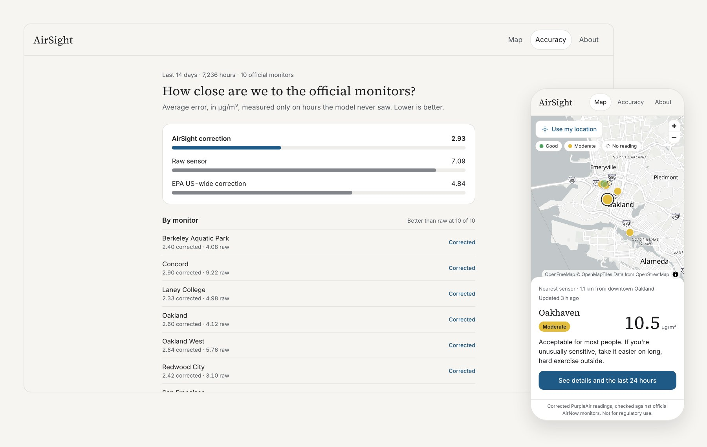
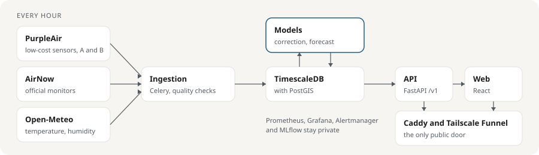

<picture>
  <source media="(prefers-color-scheme: dark)" srcset="docs/assets/readme/hero-dark.svg">
  
</picture>

The 48 hours of the last two weeks where the correction helped most, picked by scripts/readme/hero.sql. The error badge below is the live average across all stations.

[Live site](https://airsight.tailbcc5c4.ts.net) &nbsp;·&nbsp; [Accuracy, measured live](https://airsight.tailbcc5c4.ts.net/accuracy) &nbsp;·&nbsp; [Uptime](https://stats.uptimerobot.com/mJiJYV9Elv) &nbsp;·&nbsp; [API](docs/API.md) &nbsp;·&nbsp; [How it was built](docs/ARCHITECTURE.md)

Official air quality monitors are accurate but rare: the San Francisco Bay Area has 12. Low-cost
PurpleAir sensors are everywhere, over 2,600 in the same area, but they read wrong in humidity and
smoke. AirSight learns from the 39 places where a cheap sensor sits within a kilometre of an
official monitor, corrects every sensor, forecasts the next 24 hours, and publishes how accurate
it has been against official readings it never trained on.

## The result

<picture>
  <source media="(prefers-color-scheme: dark)" srcset="docs/assets/readme/results-dark.svg">
  
</picture>

Mean absolute error in µg/m³ on 14 days no model saw, with each monitor scored by a model trained
without it, averaged per station ([ADR 0007](docs/adr/0007-model-evaluation.md)). The correction
beats the EPA's US-wide correction at 7 of 10 monitors, and the forecast's 80% range held the real
value 79% of the time. There is no claim above 35.4 µg/m³ yet: the data had no smoke days. The
model cards say what else the models get wrong:
[correction](docs/model-cards/airsight-correction-v1.md),
[forecast](docs/model-cards/airsight-forecast-v1.md).

## Where to start

| 30 seconds | 5 minutes | 30 minutes |
|---|---|---|
| Open the [live site](https://airsight.tailbcc5c4.ts.net) and its [accuracy page](https://airsight.tailbcc5c4.ts.net/accuracy). The error badge above is read from it. | Read the four problems below, then the [correction model card](docs/model-cards/airsight-correction-v1.md). | The [architecture](docs/ARCHITECTURE.md), the 14 [decision records](docs/adr/), and the [engineering log](docs/engineering-log.md) of every problem hit. |

<picture>
  <source media="(prefers-color-scheme: dark)" srcset="docs/assets/readme/screens-dark.jpg">
  
</picture>

## How it works

<picture>
  <source media="(prefers-color-scheme: dark)" srcset="docs/assets/readme/system-dark.svg">
  
</picture>

Every hour, workers pull PurpleAir, AirNow and Open-Meteo data into PostgreSQL with TimescaleDB
and PostGIS, flag bad sensor hours, and store a corrected value for every reading. Every three
hours they forecast the next 24. The API only reads what the workers stored, so a request never
waits for a model ([ADR 0005](docs/adr/0005-batch-predictions.md)). Training and serving share
one package, so a feature can't mean one thing in training and another in production
([ADR 0002](docs/adr/0002-single-backend-package.md)). Prometheus, Alertmanager and Grafana watch
the jobs, the API and both models' live accuracy. Details: [ARCHITECTURE.md](docs/ARCHITECTURE.md).

## Four problems worth reading about

### 1. The metric that changed the winner

Averaged over every hour, the EPA's correction beat the raw sensor. Averaged per station, the way
a person living near one monitor experiences it, it lost: 3.95 against 3.84 µg/m³. The busiest
stations had been hiding the rest. AirSight reports the per-station average and always splits it
by pollution level. [ADR 0007](docs/adr/0007-model-evaluation.md)

### 2. Months of data on a free budget

PurpleAir's free tier is about a million points, and polling every sensor in the region would cost
2.6 million a day. Collecting only the sensors within 1 km of a monitor, and only the fields the
model needs, brought it to 4 points per sensor-hour: three months of history and months of live
data. A guard in the client refuses any request that would overspend.
[ADR 0006](docs/adr/0006-purpleair-points-budget.md)

### 3. Knowing when not to correct

Near some monitors, the correction is less accurate than the sensor itself. The system checks
every day, and where the correction has lost over at least 200 scored hours, the map shows the
raw reading and says so. It switches back on its own when the correction wins again.
[ADR 0010](docs/adr/0010-raw-fallback.md)

### 4. Production for $0, with a rollback that has already been used

A release tag builds multi-arch images, joins a private network and deploys that exact commit to
a Mac behind Tailscale Funnel. During the v0.8.0 release, the image registry timed out halfway
through. The deploy script rolled back to the previous version by itself, and the site stayed up.
[ADR 0014](docs/adr/0014-production-hosting.md) and the
[log entry](docs/engineering-log.md).

## Decisions

| Record | Chose | Over |
|---|---|---|
| [0001](docs/adr/0001-training-region.md) | Training in the San Francisco Bay Area | Malaysia, with 3 official monitors and no sensor pairs |
| [0002](docs/adr/0002-single-backend-package.md) | One backend package with several entrypoints | A package per service, where training and serving features drift apart |
| [0003](docs/adr/0003-timescaledb-postgis.md) | PostgreSQL with TimescaleDB and PostGIS | InfluxDB beside a relational database, or ClickHouse |
| [0004](docs/adr/0004-celery-redis-background-jobs.md) | Celery with Redis | Cron, RQ, Kafka or Airflow |
| [0005](docs/adr/0005-batch-predictions.md) | Predictions computed in batch by workers | A model service called on every request |
| [0006](docs/adr/0006-purpleair-points-budget.md) | Only the data training needs, within the free points | Buying points to collect everything |
| [0007](docs/adr/0007-model-evaluation.md) | Leave one station out, plus a 14-day final holdout | A random split, which leaks neighbouring hours |
| [0008](docs/adr/0008-public-api-design.md) | REST with JSON, versioned in the URL | GraphQL, or versions in a header |
| [0009](docs/adr/0009-web-app-design.md) | A small, calm design system of our own | A dense dark dashboard, or a component library's default look |
| [0010](docs/adr/0010-raw-fallback.md) | Raw readings, per monitor, where the correction loses | Always showing the correction |
| [0011](docs/adr/0011-retraining-policy.md) | All data, recent hours weighted more; a new model must win on the same final test | Only the last 60 days |
| [0012](docs/adr/0012-forecast-design.md) | Training on the weather forecast that was available at the time | The weather that actually happened, which flatters the backtest |
| [0013](docs/adr/0013-observability.md) | One exporter that reads job results from the database | A Pushgateway |
| [0014](docs/adr/0014-production-hosting.md) | A Mac behind Tailscale Funnel, at no cost | A paid VM, Oracle's free tier, or free plans that sleep |

## Run it

Requires [Docker Desktop](https://www.docker.com/products/docker-desktop/).

~~~bash
git clone https://github.com/imhammad/airsight.git
cd airsight
docker compose up -d --build --wait
curl localhost:8000/v1/health
~~~

Interactive API docs are at http://localhost:8000/docs and the dashboards at
http://localhost:3000. Stop everything with `docker compose down`. To work on the web app, run
`npm ci && npm run dev` in `web/` and open http://localhost:5173; the tests and checks are in
[CONTRIBUTING.md](CONTRIBUTING.md).

The API

A read-only public API serves the corrected readings, names the model behind every value, and
publishes its own live accuracy.

~~~bash
curl "https://airsight.tailbcc5c4.ts.net/v1/readings/nearest?lat=37.8716&lon=-122.2727&limit=1"
curl "https://airsight.tailbcc5c4.ts.net/v1/accuracy?days=7"
~~~

Endpoints, fields, errors, caching and rate limits are in the [API guide](docs/API.md). Under load,
cached requests answered in 7.2 ms at the 95th percentile.

Monitoring

Prometheus, Alertmanager and Grafana run in the same Compose stack
([ADR 0013](docs/adr/0013-observability.md)). Three dashboards show data freshness and jobs, API
traffic and latency, and the live accuracy of both models. Seven alert rules are unit-tested in
CI, and each has a section in the [runbook](docs/RUNBOOK.md). Once a day the model's recent inputs
are compared with its training data. The first check found all six had drifted, as November is
colder, wetter and cleaner than the training months, yet the model still tied one retrained on
newer data. Drift is a reason to look, not by itself a reason to retrain.

Production

AirSight runs on a Mac and is served through Tailscale Funnel at no cost
([ADR 0014](docs/adr/0014-production-hosting.md)). Caddy is the only door in: it serves the web
app and the API, and keeps the metrics and internal tools private. A release tag builds
multi-arch images, and GitHub Actions deploys that exact commit over the tailnet, checks its
health and rolls back by itself if it fails. The database is backed up daily to iCloud Drive,
and a restore check proves the backups work. Setup and operations:
[DEPLOYMENT.md](docs/DEPLOYMENT.md).

Repository layout and documentation

~~~
backend/     Python package `airsight`: API, workers, ingestion, ML (uv, FastAPI)
web/         Frontend (Vite, React, TypeScript)
infra/       Prometheus, Alertmanager, Grafana, Caddy and backup config
scripts/     The production deploy script and the README figure scripts
notebooks/   Exploration scripts, never imported by the services
docs/        Architecture, decision records, guides and the engineering log
~~~

- [Architecture](docs/ARCHITECTURE.md) and [decision records](docs/adr/)
- [Data exploration](docs/data-exploration.md): what the data looks like and what is wrong with it
- Model cards: [correction](docs/model-cards/airsight-correction-v1.md), [forecast](docs/model-cards/airsight-forecast-v1.md)
- [API guide](docs/API.md), [runbook](docs/RUNBOOK.md), [deployment guide](docs/DEPLOYMENT.md)
- [Engineering log](docs/engineering-log.md): every problem hit and how it was solved
- [Contributing](CONTRIBUTING.md), [security policy](SECURITY.md), [changelog](CHANGELOG.md)

The figures in this README are drawn by `scripts/readme/figures.py` from the project's own data.

## Releases

| Release | What it added |
|---|---|
| [v0.1.0](https://github.com/imhammad/airsight/releases/tag/v0.1.0) | Foundations: repository, Docker, CI |
| [v0.2.0](https://github.com/imhammad/airsight/releases/tag/v0.2.0) | Data ingestion from PurpleAir, AirNow and Open-Meteo |
| [v0.3.0](https://github.com/imhammad/airsight/releases/tag/v0.3.0) | A correction model that beats the EPA correction |
| [v0.4.0](https://github.com/imhammad/airsight/releases/tag/v0.4.0) | Public API |
| [v0.5.0](https://github.com/imhammad/airsight/releases/tag/v0.5.0) | Web app: map, sensor pages, live accuracy |
| [v0.6.0](https://github.com/imhammad/airsight/releases/tag/v0.6.0) | 24-hour forecast with a likely range |
| [v0.7.0](https://github.com/imhammad/airsight/releases/tag/v0.7.0) | Observability and live model monitoring |
| [v0.8.0](https://github.com/imhammad/airsight/releases/tag/v0.8.0) | Production, automatic deploys and backups |
| v1.0.0 | Public launch, in progress |

MIT licensed. Built by [@imhammad](https://github.com/imhammad).
