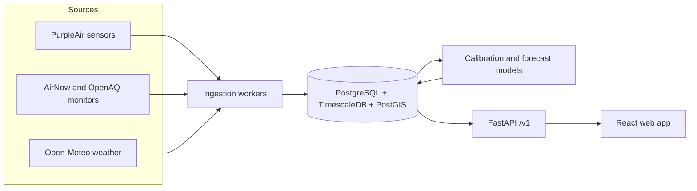

# AirSight

[](https://github.com/imhammad/airsight/actions/workflows/ci.yml)
[](LICENSE)

**Hyperlocal air quality you can trust.** AirSight corrects low-cost air quality sensor readings to
near reference-monitor accuracy and forecasts the next 24 hours of PM2.5 for any street, with a
public page that shows how accurate it is.

> **Status:** early development, `v0.1.0` (foundations). Follow progress on the
> [roadmap board](https://github.com/users/imhammad/projects/1).

## Why

Official air quality monitors are accurate but sparse: the San Francisco Bay Area has 12 of them.
Low-cost PurpleAir sensors are everywhere (over 2,600 active in the same area), but they are known
to read wrong, especially in humidity and wildfire smoke. People with asthma, parents and outdoor
workers end up choosing between data that is accurate but far away, and data that is close but wrong.

AirSight learns from the places where a low-cost sensor sits next to an official monitor, corrects
every sensor, and keeps measuring its own accuracy against fresh official readings.

## How it works (planned)



## Quickstart

Requires [Docker Desktop](https://www.docker.com/products/docker-desktop/).

```bash
git clone https://github.com/imhammad/airsight.git
cd airsight
docker compose up -d --build --wait
curl localhost:8000/v1/health
```

Interactive API docs: <http://localhost:8000/docs>. Stop everything with `docker compose down`.

## Repository layout

```
backend/     Python package `airsight`: API, workers, ingestion, ML (uv, FastAPI)
web/         Frontend (Vite, React, TypeScript)
notebooks/   Exploration scripts, never imported by the services
docs/        Architecture decisions (ADRs) and the engineering log
```

## Roadmap

| Release | Scope | Status |
|---|---|---|
| v0.1.0 | Foundations: repo, Docker, CI | ✅ |
| v0.2.0 | Data ingestion from PurpleAir, AirNow, OpenAQ, Open-Meteo | ⏳ |
| v0.3.0 | Calibration model that beats the EPA correction | ⏳ |
| v0.4.0 | Model serving and public `/v1` API | ⏳ |
| v0.5.0 | Web app: map, location detail, accuracy page | ⏳ |
| v0.6.0 | 24-hour forecast with uncertainty | ⏳ |
| v0.7.0 | Observability and live model monitoring | ⏳ |
| v1.0.0 | Public launch | ⏳ |

## Documentation

- [Architecture decisions](docs/adr/)
- [Engineering log](docs/engineering-log.md): every problem hit and how it was solved
- [Contributing](CONTRIBUTING.md)
- [Security policy](SECURITY.md)

## License

[MIT](LICENSE)
