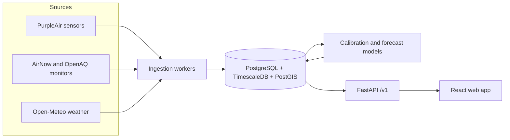

# AirSight

[](https://github.com/imhammad/airsight/actions/workflows/ci.yml)
[](LICENSE)

**Hyperlocal air quality you can trust.** AirSight corrects low-cost air quality sensor readings to
near reference-monitor accuracy and forecasts the next 24 hours of PM2.5 for any street, with a
public page that shows how accurate it is.

> **Status:** early development, `v0.8.0` (deployment). Follow progress on the
> [roadmap board](https://github.com/users/imhammad/projects/1).

## Why

Official air quality monitors are accurate but sparse: the San Francisco Bay Area has 12 of them.
Low-cost PurpleAir sensors are everywhere (over 2,600 active in the same area), but they are known
to read wrong, especially in humidity and wildfire smoke. People with asthma, parents and outdoor
workers end up choosing between data that is accurate but far away, and data that is close but wrong.

AirSight learns from the places where a low-cost sensor sits next to an official monitor, corrects
every sensor, and keeps measuring its own accuracy against fresh official readings.

## How it works (planned)



## Results (v0.3.0)

Accuracy on 14 days the model never saw, with every official monitor scored by a model trained
without that monitor's data ([ADR 0007](docs/adr/0007-model-evaluation.md)). Mean absolute error in
µg/m³, averaged over 10 Bay Area monitors:

| | All hours | Moderate pollution (9 to 35.4) |
|---|---|---|
| Raw PurpleAir | 2.87 | 4.48 |
| EPA US-wide correction | 3.42 | 6.18 |
| **AirSight** | **2.50** | **3.89** |

Better than the EPA correction at 7 of 10 monitors. No claim yet above 35.4 µg/m³: there were no
smoke days in the data. Details and limitations are in the
[model card](docs/model-cards/airsight-correction-v1.md). A retrain on 2026-11-21 tied this model
on 14 new days, so it is still the one in use.

## Forecast (v0.6.0)

Every 3 hours, AirSight forecasts each paired sensor's next 24 hours, with a range the true value
should fall inside 8 times in 10 ([ADR 0012](docs/adr/0012-forecast-design.md)). On 14 days it
never saw, mean absolute error in µg/m³ averaged over 10 monitors:

| | All horizons | 1 to 6 hours | 13 to 24 hours |
|---|---|---|---|
| Persistence (the monitor's latest reading) | 3.21 | 2.78 | 3.40 |
| Same hour yesterday | 3.24 | 3.20 | 3.26 |
| **AirSight** | **2.69** | **2.41** | **2.82** |

The range held 79% of hours. The accuracy page scores the forecast live, and the
[forecast model card](docs/model-cards/airsight-forecast-v1.md) has the details and limits.

## Web app

A calm, phone-first site on top of the API: a map of every sensor coloured by air quality, a
page per sensor with its last 24 hours, the live accuracy against official monitors, and the
method in plain words. Where the correction has been less accurate than the sensor's own reading
near a monitor, the map shows the raw reading and says so (ADR 0010).

With the stack running:

```
cd web && npm ci && npm run dev
```

Then open http://localhost:5173. The browser tests and the Lighthouse audit run in CI on every
pull request; to run them locally, see [CONTRIBUTING.md](CONTRIBUTING.md).

## API

A read-only public API serves the corrected readings, says which model produced each value, and
publishes its own live accuracy. With the stack running:

```
curl "http://localhost:8000/v1/readings/nearest?lat=37.8716&lon=-122.2727&limit=1"
curl "http://localhost:8000/v1/accuracy?days=7"
```

Endpoints, fields, errors, caching and rate limits are in the [API guide](docs/API.md), and
interactive docs are at http://localhost:8000/docs.

## Monitoring (v0.7.0)

Prometheus, Alertmanager and Grafana run in the same Compose stack
([ADR 0013](docs/adr/0013-observability.md)). Three dashboards show data freshness and jobs, API
traffic and latency, and the live accuracy of both models. Seven alert rules are unit-tested in
CI, and each has a section in the [runbook](docs/RUNBOOK.md).

Once a day, the model's inputs from the last 7 days are compared with its training data. The
first check, on 2026-11-21, found all six inputs had drifted: November is colder, wetter and
cleaner than the training months. Yet on 14 November days the model still tied one retrained
with newer data, which is why drift is a reason to look and not, by itself, to retrain.

## Production (v0.8.0)

AirSight is live at **<https://airsight.tailbcc5c4.ts.net>**, served from a Mac through
Tailscale Funnel at no cost ([ADR 0014](docs/adr/0014-production-hosting.md)). Caddy is the only
door in: it serves the web app and the API, and keeps the metrics and the internal tools
private. A release tag builds multi-arch images, and GitHub Actions deploys that exact commit
over the tailnet, checks its health and rolls back by itself if it fails. The database is backed
up daily to iCloud Drive, and a restore check proves the backups work. How to set it up and run
it: [docs/DEPLOYMENT.md](docs/DEPLOYMENT.md).

Because it runs on a home server, the site is up only while that Mac is awake and online. An
outside monitor checks the health page every 5 minutes and shows the real record on a public
[status page](https://stats.uptimerobot.com/mJiJYV9Elv).

## Quickstart

Requires [Docker Desktop](https://www.docker.com/products/docker-desktop/).

```bash
git clone https://github.com/imhammad/airsight.git
cd airsight
docker compose up -d --build --wait
curl localhost:8000/v1/health
```

Interactive API docs: <http://localhost:8000/docs>. Dashboards: <http://localhost:3000> (Grafana).
When an alert fires: [docs/RUNBOOK.md](docs/RUNBOOK.md).
Stop everything with `docker compose down`.

## Repository layout

```
backend/     Python package `airsight`: API, workers, ingestion, ML (uv, FastAPI)
web/         Frontend (Vite, React, TypeScript)
infra/       Prometheus, Alertmanager, Grafana, Caddy and backup config, dashboards as JSON
scripts/     The production deploy script
notebooks/   Exploration scripts, never imported by the services
docs/        Architecture decisions (ADRs) and the engineering log
```

## Roadmap

| Release | Scope | Status |
|---|---|---|
| v0.1.0 | Foundations: repo, Docker, CI | ✅ |
| v0.2.0 | Data ingestion from PurpleAir, AirNow and Open-Meteo | ✅ |
| v0.3.0 | Calibration model that beats the EPA correction | ✅ |
| v0.4.0 | Public API serving corrected readings | ✅ |
| v0.5.0 | Web app: map, location detail, accuracy page | ✅ |
| v0.6.0 | 24-hour forecast with uncertainty | ✅ |
| v0.7.0 | Observability and live model monitoring | ✅ |
| v0.8.0 | Deployment: production, automatic deploys, backups | ✅ |
| v1.0.0 | Public launch | ⏳ |

## Documentation

- [Architecture decisions](docs/adr/)
- [Data exploration](docs/data-exploration.md): what the data looks like and what is wrong with it
- [Model card: correction](docs/model-cards/airsight-correction-v1.md): how the correction model was tested, and its limits
- [Model card: forecast](docs/model-cards/airsight-forecast-v1.md): how the 24-hour forecast was tested, and its limits
- [API guide](docs/API.md): endpoints, fields, errors, caching, rate limits and performance
- [Runbook](docs/RUNBOOK.md): what to do when each alert fires, and how to restore the database
- [Deployment guide](docs/DEPLOYMENT.md): how production runs, how to set it up from scratch, and how to operate it
- [Engineering log](docs/engineering-log.md): every problem hit and how it was solved
- [Contributing](CONTRIBUTING.md)
- [Security policy](SECURITY.md)

## License

[MIT](LICENSE)
