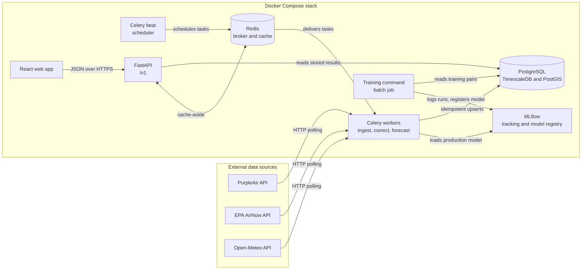
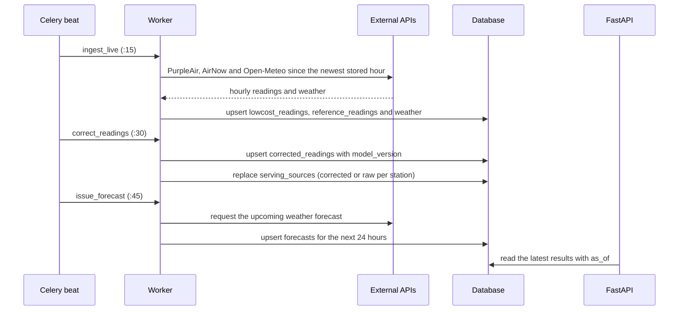

# AirSight architecture

- **Status:** Current as of v1.0.0. The migrations in `backend/src/airsight/migrations` are the
  source of truth for the schema.
- **Decisions behind this document:** the 14 ADRs in [`docs/adr/`](adr/).

## What the system does

AirSight pulls readings from low-cost PurpleAir sensors, official EPA monitors (AirNow) and weather
(Open-Meteo). A model corrects each low-cost reading toward what an official monitor would report,
and a second model forecasts the next 24 hours with an uncertainty range. Results are stored with the
model version that produced them, served by a versioned API, and shown on a web map with a public
accuracy page.

## Components

| Component | Role | Code |
|---|---|---|
| Celery beat | The only scheduler. Exactly one instance, in its own container. | `airsight.worker` |
| Celery workers | Live ingestion, correction and the raw fallback choice, forecasts, and the daily quality, drift and day-ahead weather jobs. | `airsight.worker`, `airsight.ingestion`, `airsight.ml` |
| PostgreSQL | All data: time series, locations, predictions, run history. | Alembic migrations |
| Redis | Celery broker (database 0) and API cache (database 1). | |
| MLflow | Experiment tracking and the model registry. | |
| Training command | Builds training pairs, trains, evaluates, registers a model. Not a Celery task. | `airsight.ml` |
| FastAPI | Read-only public API under `/v1`, plus its own request metrics at `/metrics`. | `airsight.api` |
| Exporter | Data freshness, job runs, queue length and live accuracy for Prometheus, read from the database and Redis on each scrape ([ADR 0013](adr/0013-observability.md)). | `airsight.observability` |
| Web app | Map, sensor pages and the accuracy page. | `web/` |
| Prometheus | Scrapes the API and the exporter every 15 seconds, keeps 30 days, evaluates alert rules. | `infra/prometheus` |
| Alertmanager | Groups firing alerts. In production it sends each one, and its all-clear, to a Telegram bot ([deployment guide](DEPLOYMENT.md#13-alerts-on-your-phone)); locally it sends nowhere. | `infra/alertmanager` |
| Grafana | Pipeline, API and Model dashboards, provisioned from files. | `infra/grafana` |

Monitoring follows [ADR 0013](adr/0013-observability.md). Locally, Grafana is at
<http://localhost:3000>, Prometheus at <http://localhost:9090> and Alertmanager at
<http://localhost:9093>. Dashboards are JSON files in `infra/grafana/dashboards`: changes made in
Grafana's editor are not saved, so edit the file (or export the dashboard into it) and restart
Grafana.

Alert rules are in `infra/prometheus/rules`, with unit tests that CI runs with `promtool`. What
to do when one fires is in the [runbook](RUNBOOK.md).

## The regular cycle

Celery beat runs every job on a fixed UTC schedule (`worker/celery_app.py`). Every 3 hours three
jobs run 15 minutes apart, each using what the one before it stored.

| Job | When (UTC) | What it does |
|---|---|---|
| `ingest_live` | every 3 hours at :15 | Fetches PurpleAir hourly averages, AirNow monitor readings and Open-Meteo weather since the newest stored hour |
| `correct_readings` | every 3 hours at :30 | Recomputes the last 48 hours of corrections with the champion, then picks corrected or raw for each station ([ADR 0010](adr/0010-raw-fallback.md)) |
| `issue_forecast` | every 3 hours at :45 | Forecasts the next 24 hours for every served sensor ([ADR 0012](adr/0012-forecast-design.md)) |
| `check_quality` | daily at 01:45 | Excludes sensors with broken or disagreeing channels |
| `check_drift` | daily at 02:15 | Compares the last 7 days of model inputs with the champion's training data |
| `load_day_ahead_weather` | daily at 04:45 | Stores Open-Meteo's day-ahead weather forecasts, which the forecast model trains on |

A network error makes `ingest_live` retry every 10 minutes for up to 50 minutes, and
`issue_forecast` every 15 minutes for an hour, so a short outage on the server costs minutes
instead of a whole 3-hour slot. A rejected request (a bad key, a malformed query) fails at once.

## Data rules

- **Time and units:** every timestamp is UTC (`timestamptz`). PM2.5 is always in µg/m³.
- **Time grain:** everything is hourly. Official monitors report hourly, so PurpleAir is asked for
  hourly averages and weather is stored per hour.
- **Idempotency:** Celery may run a task twice (ADR 0004). Every write is an upsert on a natural key
  (`INSERT ... ON CONFLICT DO UPDATE`), so a rerun changes nothing.
- **Catching up:** live ingestion starts from the newest stored hour of each source, so a missed run
  is filled in by the next one: up to 3 days back for AirNow, and up to 24 hours per sensor for
  PurpleAir, so one run can't drain the points budget ([ADR 0006](adr/0006-purpleair-points-budget.md)).
- **Run history:** every task run writes a row to `ingestion_runs` (status, row count, error).
- **Backfills:** historical downloads are split into one task per source per day, so a failure
  retries one day, not the whole history.

## When things fail

| Failure | What the system does | What users see |
|---|---|---|
| A source unreachable (network or provider down) | The HTTP client retries with backoff, then the whole run retries every 10 minutes for 50 minutes. After that the run fails, JobFailing and DataStale alert, and the next run catches up. | The last values, with their `as_of` time. |
| The correction does worse than raw at a station | The sensors paired with that monitor show raw readings until the correction wins again ([ADR 0010](adr/0010-raw-fallback.md)). | Raw readings, labelled raw. |
| AirNow data late | Corrections don't need it. Accuracy is computed when the data arrives. | The accuracy page updates later. |
| No working production model | Prediction tasks fail and alert. Ingestion carries on. Stored predictions stay. | The last predictions, with `as_of`. |
| Worker crashes mid-task | The task is delivered again (late acknowledgement). Upserts make the rerun safe. | Nothing. |
| Redis down | No new tasks run. The API skips the cache and reads the database. | Slower responses, older data. |
| Database down | Workers retry. The API health check fails and returns 503. | An error page. |
| The server (the Mac) asleep or offline | Nothing runs. On wake every job catches up, and the forecast retries for an hour until fresh readings exist. UptimeRobot reports the downtime. | The site is unreachable. |

## API rules

- **Versioning:** everything lives under `/v1`. Within v1, changes are additive only: new endpoints or
  new optional fields. A breaking change means `/v2`, with both running during a deprecation period.
- **Freshness:** every response that contains data includes `as_of`, and predictions include
  `model_version`.
- **Caching:** cache-aside in Redis, keyed by path and query parameters. Time-to-live values follow
  how often the data changes: latest readings and forecasts 5 minutes, accuracy 15 minutes, past
  history and the model 1 hour ([API guide](API.md#caching)).
- **Endpoints:** listed in the [API guide](API.md#endpoints).

## In production

Production runs the same Compose stack on a Mac, with `docker-compose.prod.yml` on top: Caddy in
front on `127.0.0.1:8080`, Tailscale Funnel for the public HTTPS address, images built by CI,
deploys over the tailnet on each release tag, a daily backup service, and alerts to Telegram
([ADR 0014](adr/0014-production-hosting.md), [deployment guide](DEPLOYMENT.md)).

## Database schema

The migrations in `backend/src/airsight/migrations/versions` create the schema, and
`core/tables.py` mirrors them for the application code (`tests/test_migrations.py` fails if the two
drift apart). The six time series tables are TimescaleDB hypertables, partitioned on `time`
(`forecasts` on `issue_time`). Every timestamp is UTC.

| Table | What it holds | Written by |
|---|---|---|
| `sensors` | Every PurpleAir sensor and official monitor, with its PostGIS location and weather cell | backfill, `ingest_live` |
| `sensor_pairs` | Each low-cost sensor within 1 km of an official monitor, with the distance | backfill |
| `lowcost_readings` | Hourly PurpleAir channels A and B, humidity and temperature, plus quality flags PostgreSQL computes | `ingest_live` |
| `reference_readings` | Hourly official PM2.5, the ground truth | `ingest_live` |
| `weather` | Hourly observed weather per 0.1 degree grid cell | `ingest_live` |
| `day_ahead_weather` | The weather as forecast a day before each hour, so the forecast model never trains on the future ([ADR 0012](adr/0012-forecast-design.md)) | `load_day_ahead_weather` |
| `sensor_health` | Each sensor's latest quality verdict and the numbers behind it | `check_quality` |
| `corrected_readings` | One corrected PM2.5 value per sensor-hour, with the model version | `correct_readings` |
| `serving_sources` | Corrected or raw, per sensor, with the 14-day scores that decided it ([ADR 0010](adr/0010-raw-fallback.md)) | `correct_readings` |
| `forecasts` | Every issued 24-hour forecast with its p10 to p90 range, kept so it can be scored later | `issue_forecast` |
| `input_drift` | The daily drift score of each model input | `check_drift` |
| `ingestion_runs` | One row per job run: status, rows written, error | every job |

Model versions are not duplicated in a table: the MLflow registry owns them, and every prediction
row stores the version string it came from.
