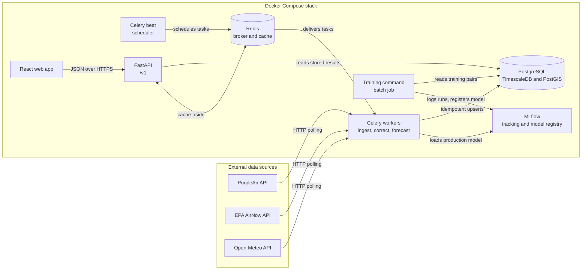
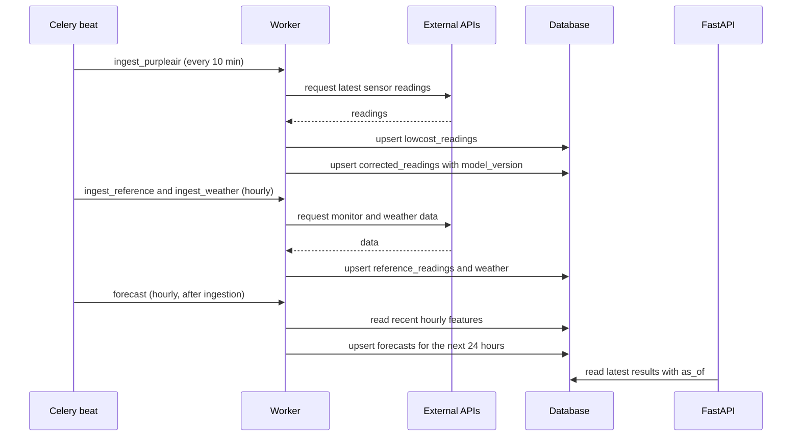

# AirSight architecture

- **Status:** Draft for v0.2.0. Alembic migrations become the source of truth for the schema in Phase 4.
- **Decisions behind this document:** ADR 0001 (training region) to ADR 0005 (batch predictions), in `docs/adr/`.

## What the system does

AirSight pulls readings from low-cost PurpleAir sensors, official EPA monitors (AirNow) and weather
(Open-Meteo). A model corrects each low-cost reading toward what an official monitor would report,
and a second model forecasts the next 24 hours with an uncertainty range. Results are stored with the
model version that produced them, served by a versioned API, and shown on a web map with a public
accuracy page.

## Components



| Component | Role | Code |
|---|---|---|
| Celery beat | The only scheduler. Exactly one instance, in its own container. | `airsight.worker` |
| Celery workers | Ingestion, correction and forecast tasks. | `airsight.worker`, `airsight.ingestion`, `airsight.ml` |
| PostgreSQL | All data: time series, locations, predictions, run history. | Alembic migrations |
| Redis | Celery broker (database 0) and API cache (database 1). | |
| MLflow | Experiment tracking and the model registry. | |
| Training command | Builds training pairs, trains, evaluates, registers a model. Not a Celery task. | `airsight.ml` |
| FastAPI | Read-only public API under `/v1`. | `airsight.api` |
| Web app | Map, sensor pages and the accuracy page. | `web/` |

Prometheus and Grafana join the stack in the observability phase.

## The regular cycle



## Data rules

- **Time and units:** every timestamp is UTC (`timestamptz`). PM2.5 is always in µg/m³.
- **Time grain:** raw readings are stored as received (about every 10 minutes). Training, evaluation
  and forecasts use hourly averages, because official monitors report hourly. A TimescaleDB
  continuous aggregate (`lowcost_hourly`) keeps those averages up to date.
- **Idempotency:** Celery may run a task twice (ADR 0004). Every write is an upsert on a natural key
  (`INSERT ... ON CONFLICT DO UPDATE`), so a rerun changes nothing.
- **Catching up:** each ingestion task starts from the last successful timestamp for its source, so a
  missed run is filled in by the next one.
- **Run history:** every task run writes a row to `ingestion_runs` (status, row count, error).
- **Backfills:** historical downloads are split into one task per source per day, so a failure
  retries one day, not the whole history.

## When things fail

| Failure | What the system does | What users see |
|---|---|---|
| PurpleAir down or rate limited | Retries with exponential backoff, marks the run failed, catches up on the next run. | The last values, with their `as_of` time. |
| AirNow data late | Corrections don't need it. Accuracy is computed when the data arrives. | The accuracy page updates later. |
| No working production model | Prediction tasks fail and alert. Ingestion carries on. Stored predictions stay. | The last predictions, with `as_of`. |
| Worker crashes mid-task | The task is delivered again (late acknowledgement). Upserts make the rerun safe. | Nothing. |
| Redis down | No new tasks run. The API skips the cache and reads the database. | Slower responses, older data. |
| Database down | Workers retry. The API health check fails and returns 503. | An error page. |

## API rules

- **Versioning:** everything lives under `/v1`. Within v1, changes are additive only: new endpoints or
  new optional fields. A breaking change means `/v2`, with both running during a deprecation period.
- **Freshness:** every response that contains data includes `as_of`, and predictions include
  `model_version`.
- **Caching:** cache-aside in Redis, keyed by path and query parameters. Time-to-live values follow
  how often the data changes: latest readings 60 seconds, forecasts 5 minutes, accuracy 1 hour.
- **Planned endpoints:** `/v1/health`, `/v1/sensors`, `/v1/sensors/{id}/readings`,
  `/v1/sensors/{id}/forecast`, `/v1/accuracy`.

## Database schema draft

```sql
-- Every station, low-cost or official. location uses PostGIS (WGS 84).
CREATE TABLE sensors (
    id              bigint GENERATED ALWAYS AS IDENTITY PRIMARY KEY,
    source          text NOT NULL,              -- 'purpleair' | 'airnow'
    source_id       text NOT NULL,              -- the id in the source system
    kind            text NOT NULL,              -- 'lowcost' | 'reference'
    name            text,
    location        geography(Point, 4326) NOT NULL,
    weather_cell_id text,                       -- weather grid cell (lat and lon rounded to 0.1 degrees)
    active          boolean NOT NULL DEFAULT true,
    UNIQUE (source, source_id)
);

-- Hypertable. PurpleAir sensors have two laser counters (A and B).
CREATE TABLE lowcost_readings (
    sensor_id   bigint NOT NULL REFERENCES sensors (id),
    time        timestamptz NOT NULL,
    pm25_a      real,
    pm25_b      real,
    humidity    real,
    temperature real,
    PRIMARY KEY (sensor_id, time)
);

-- Hypertable. Hourly official PM2.5, the ground truth.
CREATE TABLE reference_readings (
    sensor_id bigint NOT NULL REFERENCES sensors (id),
    time      timestamptz NOT NULL,
    pm25      real NOT NULL,
    PRIMARY KEY (sensor_id, time)
);

-- Hypertable. Hourly weather per grid cell, shared by nearby sensors.
CREATE TABLE weather (
    cell_id           text NOT NULL,
    time              timestamptz NOT NULL,
    temperature       real,
    relative_humidity real,
    wind_speed        real,
    wind_direction    real,
    precipitation     real,
    PRIMARY KEY (cell_id, time)
);

-- Hypertable. The same columns, as forecast 24 hours before each hour (ADR 0012). Only the
-- air quality forecast trains on it, so future weather never leaks into its inputs.
CREATE TABLE day_ahead_weather (
    cell_id           text NOT NULL,
    time              timestamptz NOT NULL,
    temperature       real,
    relative_humidity real,
    wind_speed        real,
    wind_direction    real,
    precipitation     real,
    PRIMARY KEY (cell_id, time)
);

-- Low-cost sensors within 2 km of an official monitor, refreshed with PostGIS ST_DWithin.
CREATE TABLE sensor_pairs (
    reference_sensor_id bigint NOT NULL REFERENCES sensors (id),
    lowcost_sensor_id   bigint NOT NULL REFERENCES sensors (id),
    distance_m          real NOT NULL,
    PRIMARY KEY (reference_sensor_id, lowcost_sensor_id)
);

-- Hypertable. One corrected value per reading per model version.
CREATE TABLE corrected_readings (
    sensor_id      bigint NOT NULL REFERENCES sensors (id),
    time           timestamptz NOT NULL,
    model_version  text NOT NULL,
    pm25_corrected real NOT NULL,
    PRIMARY KEY (sensor_id, time, model_version)
);

-- Hypertable on target_time. Each hourly run forecasts the next 24 hours with a range.
CREATE TABLE forecasts (
    sensor_id     bigint NOT NULL REFERENCES sensors (id),
    issued_at     timestamptz NOT NULL,
    target_time   timestamptz NOT NULL,
    model_version text NOT NULL,
    pm25_p10      real NOT NULL,
    pm25_p50      real NOT NULL,
    pm25_p90      real NOT NULL,
    PRIMARY KEY (sensor_id, issued_at, target_time, model_version)
);

-- One row per task run, for debugging and monitoring.
CREATE TABLE ingestion_runs (
    id            bigint GENERATED ALWAYS AS IDENTITY PRIMARY KEY,
    task          text NOT NULL,
    started_at    timestamptz NOT NULL,
    finished_at   timestamptz,
    status        text NOT NULL,                -- 'running' | 'succeeded' | 'failed'
    rows_upserted integer,
    error         text
);
```

Model versions are not duplicated in a table: the MLflow registry owns them, and every prediction
row stores the version string it came from.
