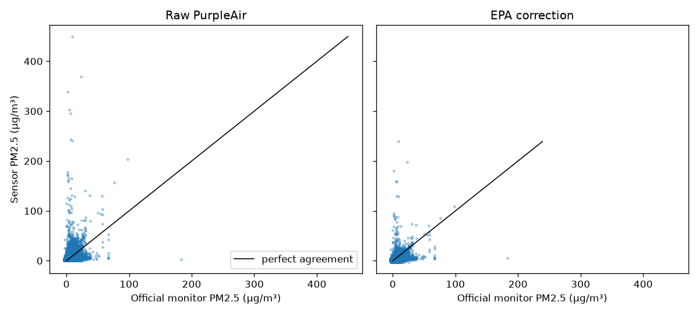
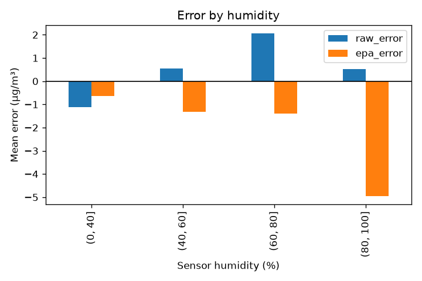

# Data exploration: PurpleAir sensors vs official monitors

Issues #33 and #35 · updated 2026-11-04 · Script: `notebooks/01_explore_pairs.py`

## Why this exists

Before building a correction model we need to know what the data looks like: how complete it is,
which sensors are broken, and how good the existing EPA correction already is. These numbers are
the baselines every AirSight model must beat.

## Data

- 3 months: 2026-08-06 to 2026-11-04 (UTC), loaded by the backfill and kept current by the
  live job every 3 hours.
- 41 PurpleAir sensors within 1 km of 12 AirNow monitors in the San Francisco Bay Area.
- 80,853 paired sensor-hours. Median sensor coverage 100%; 4 sensors under 75%.
- 5.6% of hours have no official reading to compare against.

Reproduce:

```bash
uv run --project backend --group notebooks python notebooks/01_explore_pairs.py
```

## Sensor health

Each PurpleAir sensor has two laser counters, A and B. We flag an hour when the counters disagree
(EPA rule: more than 5 µg/m³ AND more than 70% apart), when either reads above 1,000 µg/m³
(impossible), or when both read exactly zero.

| Sensor | Monitor | Problem | Decision |
|---|---|---|---|
| 120181 | Concord | A median 4,989.8, B near 0; 61% impossible | Exclude |
| 162567 | San Jose Jackson St | B up to 5,633; 42% impossible | Exclude |
| 195905 | San Jose Jackson St | Both counters around 5,000; 100% impossible | Exclude |
| 119499 | San Rafael | A about 4,992, B 0; 100% impossible | Exclude |
| 194669 | Oakland West | Both counters spike to about 5,000; 20% impossible | Exclude |
| 64777 | San Francisco | Rare spikes (A max 1,939) | Keep; flag those hours |
| 90563 | Vallejo | Rare spikes (max 1,042) | Keep; flag those hours |
| Knox Ave sensor | San Jose Knox Ave | Reads 0.1 while the monitor reads 8.6; passes every check | Needs a new check (#36) |

**Rule:** a sensor is excluded when more than 10% of its hours are impossible. Otherwise bad
hours are flagged, not deleted. After all checks, **59,219 of 80,853 hours (73%) are trustworthy**.

## Raw vs EPA correction

Error = sensor minus official monitor, in µg/m³, on trustworthy hours.
EPA US-wide correction (Barkjohn et al. 2021): `0.524 * raw - 0.0862 * RH + 5.75`.

| Method | Mean error | Mean absolute error | Correlation |
|---|---|---|---|
| Raw (average of A and B) | +0.53 | 3.65 | 0.34 |
| EPA correction | -1.57 | 3.21 | 0.35 |

Over 3 months the EPA correction beats raw overall, but it reads low on average and pushes some
monitors far below the truth (Berkeley 0.4 vs 6.0 official, Laney 1.5 vs 7.5, Redwood City 1.8
vs 6.6). Correlation is low for both because most hours sit in a narrow, clean range where
sensor noise dominates.



### By pollution level (US AQI bands)

| Official PM2.5 | Hours | Raw MAE | EPA MAE |
|---|---|---|---|
| Good (up to 9) | 47,745 | 3.23 | **2.51** |
| Moderate (9 to 35) | 9,679 | **5.48** | 6.38 |
| Unhealthy for sensitive groups or worse (above 35) | 42 | 43.63 | 35.65 |

EPA helps on clean days and hurts on moderately polluted ones. There were only 42 hours above
35 µg/m³ and both methods were far off, so we know almost nothing yet about smoky days.

### By humidity

| Sensor humidity | Hours | Raw mean error | EPA mean error |
|---|---|---|---|
| Up to 40% | 12,223 | -1.12 | -0.64 |
| 40 to 60% | 27,765 | +0.54 | -1.33 |
| 60 to 80% | 13,157 | +2.06 | -1.40 |
| Above 80% | 6,074 | +0.52 | -4.96 |

Raw readings rise with humidity (particles swell with water), and EPA's single humidity term
over-corrects in very humid air. A model that learns this relationship should beat both.



### By month

| Month | Hours | Official mean | Raw MAE | EPA MAE |
|---|---|---|---|---|
| 2026-08 | 15,797 | 4.72 | 3.74 | 3.00 |
| 2026-09 | 19,489 | 6.47 | 3.54 | 3.29 |
| 2026-10 | 21,665 | 6.44 | 3.71 | 3.26 |
| 2026-11 (partial) | 2,268 | 5.22 | 3.43 | 3.36 |

Errors are stable month to month, so there is no obvious seasonal drift in this window.

## Decisions

1. Exclude sensors 120181, 162567, 195905, 119499 and 194669 (more than 10% impossible hours).
2. Keep the EPA A/B disagreement rule; flag bad hours rather than deleting them (#36).
3. Add a check for sensors that sit near zero while their monitor does not (#36).
4. **The target for v0.3:** beat the EPA correction's MAE of 3.21 µg/m³ under leave-one-station-out
   evaluation, without doing worse than raw on moderate days.
5. Always report results by pollution level, not only overall, so a model can't hide a bad
   result on polluted days behind many clean ones.
6. Until we have smoke data, the forecast widens its uncertainty above 35 µg/m³.

## Limits

- Almost no high-pollution hours (42 above 35 µg/m³). This is the biggest risk for the model.
- Four monitors (Oakland West, San Francisco, Vallejo, San Rafael) hold most of the paired hours,
  so pooled numbers lean towards them. Leave-one-station-out evaluation (ADR 0001) controls for this.
- The sensor's humidity is measured inside its housing and reads lower than outdoor humidity.

## Next steps

- #36: turn the checks above into stored data quality flags and a report.
- Phase 5: train the correction model and compare it with these baselines.
